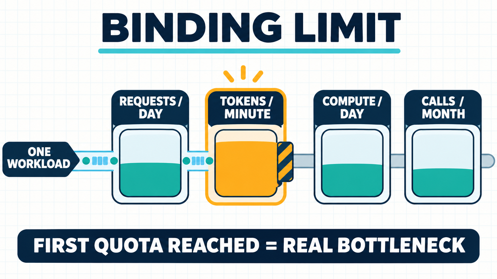

# Free AI APIs Compared: Usage Limits, Model Access, and Credit Card Requirements

*A free route is usable only when its quota, model access, and payment conditions all fit the workload.*

*A practical comparison of five hosted routes for prototypes, with one workload tested against requests, tokens, and compute limits.*

There is no single best free AI API. The useful choice depends on what makes the usage free and which limit your workload reaches first.

- Start with **Google's Gemini Developer API** if you need eligible Gemini models and your project qualifies for its model-specific Free tier.
- Start with **GroqCloud** if the models in its current catalog fit and you want published request and token limits to size a bursty prototype.
- Start with **OpenRouter** if trying a changing pool of free models through one interface matters more than a stable production contract.
- Start with **Cloudflare Workers AI** if your chosen model and daily token volume fit its shared Neuron allowance.
- Start with **Cohere** if you are evaluating Cohere models and accept that the free key is an evaluation key, not a production plan.

None is unlimited. A route can fit 500 requests across a day and still fail in one busy minute, on token throughput, or because the exact model is not free. Credit-card answers also need care: “no payment option” is documented for OpenRouter's Free plan, while several other official pages describe an upgrade trigger without promising that every new account can start card-free.

The comparison uses provider documentation checked on November 3, 2026. It does not rely on signing up for accounts or making test calls.

## First decide what “free” means

A zero price can come from several different mechanisms:

| Free mechanism | Plain-language meaning | What usually stops you |
|---|---|---|
| Recurring free tier | Selected models have a zero price within account limits | A request, token, daily, or eligibility limit |
| Free model variant | A provider or router marks particular model routes as free | A small daily cap or a changing model pool |
| Daily compute allowance | Every model consumes a shared pool in different amounts | The chosen model exhausts the pool |
| Evaluation key | A limited key is issued for testing | Monthly calls, endpoint limits, or production rules |
| Promotional credit | A temporary balance pays normal prices | The credit or promotion expires |

This article compares the first four and excludes short-lived promotional credits. It also excludes self-hosting: downloadable model weights may avoid a per-request API bill, but hardware and operations make that a different decision.

The **binding limit** is the first limit your workload hits. Think of several doors in a corridor: requests per day may be open, but requests per minute or tokens per minute can still be locked. One API key does not necessarily create another allowance; Google applies Gemini limits per project, and Groq describes organization-level limits.

*The binding limit is whichever quota the workload reaches first; in this example, the busy-minute token limit stops it before the other allowances are exhausted.*

Model access is a separate question. A plan can cost zero while the model or capability you need is paid-only. Finally, “free to start” and “no credit card required” are not synonyms. The safe comparison records the exact payment statement the provider publishes and labels anything else as unknown.

## The five free routes at a glance

| Route | What is free | Main capacity check | Model-access catch | Documented payment point |
|---|---|---|---|---|
| Google Gemini Developer API | Input and output on selected Free-tier models | Per-project RPM, TPM, and RPD shown for the active account | Not every model, project, or account qualifies | Tier 1 requires an active billing account; universal card-free signup is not established |
| GroqCloud Free | Requests to models available on the Free tier | Organization-level RPM, RPD, TPM, and TPD | Limits vary by model and account | A valid payment method is required to upgrade to Developer |
| OpenRouter Free | A changing pool of 25+ free models on the checked plan | 20 RPM and 50 RPD for `:free` variants | Pool and underlying provider routes can change | Free plan lists no payment option; buying credits raises the cited daily cap |
| Cloudflare Workers AI | 10,000 Neurons per day | Model-specific input/output conversion to Neurons | Some models require a paid billing method | The pricing page does not establish a universal signup card rule |
| Cohere trial key | Free, rate-limited model evaluation | 1,000 calls per month plus endpoint limits | Evaluation access is distinct from production access | Registration page says users receive a trial key; reviewed pages do not state a card rule |

This is not a quality ranking. A small daily cap can be enough for a classroom demo, while a larger allowance can still be useless if it excludes the required model. First remove routes that fail model, modality, governance, or payment constraints. Then compare capacity using your normal day and busiest minute. Test answer quality and latency separately with your own prompts; this documentation comparison cannot establish either one.

## Where each route fits and where it stops fitting

Use the table as a filter, not a final answer:

- **Google** fits an eligible Gemini experiment when the exact model has a Free-tier row and the project's live limits cover the workload. It stops fitting when the account is ineligible, data-use terms are unsuitable, or the required model is paid-only.
- **Groq** fits a model from its current catalog when both the daily volume and burst-time tokens fit. It stops fitting when a busy minute exceeds TPM even though daily requests remain.
- **OpenRouter** fits exploration across several free models. It stops fitting when 50 daily requests are insufficient or a changing route is unacceptable.
- **Cloudflare** fits workloads already close to the Workers ecosystem when the model-specific Neuron calculation stays below 10,000 per day. It stops fitting when a heavier model consumes the allowance too quickly.
- **Cohere** fits a bounded evaluation of Cohere endpoints. It stops fitting when the team needs production terms or more than 1,000 calls per month.

## Google: broad Gemini experimentation, with eligibility and data-use conditions

Google's [Gemini Developer API pricing table](https://ai.google.dev/gemini-api/docs/pricing) marks free access model by model. That is more useful than treating “Gemini API” as one price: a model with free input and output can sit beside one that has no Free-tier access.

Capacity also has several dimensions. Google's [rate-limit guide](https://ai.google.dev/gemini-api/docs/rate-limits) explains requests per minute (RPM), tokens per minute (TPM), and requests per day (RPD), and says limits apply per project rather than per key. The exact active allowance belongs in your calculation because the published guide directs users to AI Studio for current project limits.

Two less-visible conditions can change the choice. First, Google's troubleshooting material says not every account or project is eligible for the Free tier. Creating another key in the same restricted project does not change that. Second, the pricing page says Free-tier content may be used to improve Google products, while the paid tier states otherwise. For confidential or regulated prompts, that policy difference can disqualify the free route before capacity matters.

**Choose Google when:** the exact Gemini model is free for your eligible project, its live limits fit the workload, and the Free-tier data terms are acceptable.

**Reconsider when:** eligibility is missing, the required model has no free row, or your data rules require the paid treatment.

## Groq: clear model-level limits, but the busiest minute can decide

Groq's value for planning is the shape of its quota table. The [GroqCloud rate-limit page](https://console.groq.com/docs/rate-limits) lists requests and tokens per minute and per day, with limits applied at the organization level. At the time checked, examples including `openai/gpt-oss-120b` and `qwen/qwen3.8-27b` showed 30 RPM, 1,000 RPD, 8,000 TPM, and 200,000 TPD.

Those four numbers describe different failure modes. A workload can remain below 30 requests in a minute but exceed 8,000 tokens because each prompt or answer is long. It can also pass the daily request count and fail the daily token count. The current account page remains authoritative because models and allowances can change.

Groq documents a payment method at a clear transition: upgrading from Free to the Developer tier requires one. That does not prove the signup condition for every account, so this comparison does not label Groq universally “no card required.”

**Choose Groq when:** a listed model meets the product need and both burst-time and daily token calculations fit the current allowance.

**Reconsider when:** your traffic arrives in bursts, prompts are long, or moving beyond Free would violate a no-payment-method constraint.

## OpenRouter: a broad free pool with a small ceiling

OpenRouter's checked pricing page lists more than 25 free models and no payment option for its Free plan. Its [free-model collection](https://openrouter.ai/collections/free-models) explains the practical limits for `:free` model variants: 20 requests per minute and 50 requests per day. Failed attempts count toward the daily cap.

This makes the route easy to understand for lightweight exploration. Fifty daily calls can support a prompt comparison, a small demo, or a manual evaluation set. It will not support the 500-request workload used later in this article.

The model pool also changes. A zero-priced route is therefore access for experimentation, not evidence of a stable production contract. Buying the stated amount of credits raises the cited daily cap to 1,000 requests, but that is no longer a zero-spend route even if individual calls still use free model variants.

**Choose OpenRouter when:** you want one interface for trying several free models and can keep usage well below the daily cap.

**Reconsider when:** a specific model/provider route must remain available, failed calls are frequent, or the application needs more than 50 requests per day without buying credits.

## Cloudflare: calculate the model, not just the request count

Cloudflare Workers AI uses a shared compute allowance instead of a simple request quota. Its [Workers AI pricing page](https://developers.cloudflare.com/workers-ai/platform/pricing/) lists 10,000 Neurons per day on both Free and Paid Workers plans, resetting at 00:00 UTC.

A **Neuron** is Cloudflare's unit for model work. Each model consumes a different number of Neurons per million input and output tokens. The decision consequence is simple: two APIs receiving the same 500 requests can have opposite results because the model conversion rates differ.

Using the checked rows, Llama 3.2 1B was listed at 2,457 Neurons per million input tokens and 18,252 per million output tokens. `gpt-oss-20b` was listed at 18,182 and 27,273 respectively. The heavier input rate changes the daily fit in the worked example below.

Some model rows also say a paid billing method is required. The existence of a 10,000-Neuron allowance does not override a model-specific billing condition.

**Choose Cloudflare when:** your exact model's conversion, including input and output, fits the daily pool with headroom.

**Reconsider when:** you selected the route from request count alone, need a paid-only model, or cannot tolerate the daily reset boundary.

## Cohere: useful for evaluation, not a free production promise

Cohere describes two different key types. Its [API key and rate-limit documentation](https://docs.cohere.com/v2/docs/rate-limits) calls evaluation keys free and limited, while production keys are paid. Trial keys are capped at 1,000 API calls per month and also have endpoint-specific per-minute limits.

That distinction matters more than the word “free.” An evaluation key can answer whether a Cohere model works for your sample prompts. It does not establish that the same key, allowance, or terms are appropriate for end users. Cohere's separate going-live guidance also places production and sensitive-use decisions beyond simple registration.

The reviewed registration guidance says every user receives a free, rate-limited trial key. It does not state whether a credit card is required in every signup path, and this article did not create an account. The accurate status is therefore **not stated in the reviewed documentation**, rather than “no card required.”

**Choose Cohere when:** you are running a bounded evaluation under 1,000 monthly calls and will make a separate production decision.

**Reconsider when:** you need a free production route, higher monthly volume, or endpoint limits that the evaluation key cannot support.

## Work one real workload through every quota

Suppose a prototype handles:

- 500 requests on a normal day;
- 8 requests in its busiest minute;
- 1,000 input tokens and 300 output tokens per request;
- no retries in the first calculation.

The busiest minute carries 10,400 combined tokens: `8 × (1,000 + 300)`. The day carries 500,000 input tokens and 150,000 output tokens.

| Route | Result for this workload | What binds or remains unknown |
|---|---|---|
| Google | Cannot be decided from a generic table | Compare 8 RPM, 10,400 TPM, and 500 RPD with the exact model and active project's limits |
| Groq examples cited above | Fails the busy-minute token test | 10,400 TPM exceeds the published 8,000 TPM example, even though 8 RPM is below 30 |
| OpenRouter Free | Fails the daily request test | 500 RPD exceeds 50 RPD |
| Cloudflare, Llama 3.2 1B | Fits the daily Neuron allowance | About 3,966 Neurons/day |
| Cloudflare, `gpt-oss-20b` | Exceeds the daily Neuron allowance | About 13,182 Neurons/day |
| Cohere trial key | Fails sustained monthly volume | 500 requests/day would exceed 1,000 calls in two days |

The Cloudflare calculation is:

`daily Neurons = (input tokens ÷ 1,000,000 × input rate) + (output tokens ÷ 1,000,000 × output rate)`

For Llama 3.2 1B:

`(500,000 ÷ 1,000,000 × 2,457) + (150,000 ÷ 1,000,000 × 18,252) = 3,966.3`

For `gpt-oss-20b`:

`(500,000 ÷ 1,000,000 × 18,182) + (150,000 ÷ 1,000,000 × 27,273) = 13,181.95`

This example does not say which model is better. It proves why the provider name and request count are insufficient. Add retries, longer outputs, traffic growth, and background jobs before treating a passing calculation as capacity. A 25–50% planning margin is a business assumption, not a provider guarantee.

## Credit-card requirements: record the trigger, not a guessed badge

The clearest answer from the checked sources is OpenRouter's: its Free plan lists “No” under payment options. The other routes need more precise language:

- **Google:** Free-tier qualification and account eligibility vary. Moving to Tier 1 requires an active billing account. That does not establish one universal card rule for every Free-tier account.
- **Groq:** upgrading from Free to Developer requires a valid payment method. The reviewed billing FAQ does not establish a universal signup rule.
- **Cloudflare:** the Workers AI page documents a daily allowance, while some model rows require a paid billing method. It does not provide one universal signup-card statement.
- **Cohere:** registration guidance says users receive a free trial key, but the reviewed pages do not state a card requirement.

“Not stated” is an actionable result. If your organization cannot enter a payment method, verify the current signup screen and terms before writing integration code. If a payment method is allowed but charges are not, also check whether an upgrade is manual, whether spending limits exist, and what happens after free capacity is exhausted. Do not infer those controls from the word “free.”

## Why Hugging Face is not in the free shortlist

Many third-party lists still describe Hugging Face Inference Providers as including a small monthly credit for free users. The current [Inference Providers pricing documentation](https://huggingface.co/docs/inference-providers/en/pricing) checked for this article says Free users receive no included monthly credits and can use the service by purchasing credits or upgrading to PRO.

That makes it a useful warning about stale comparisons, not a current zero-spend recommendation. Hugging Face may still be relevant for model discovery, self-hosting, or paid inference, but those are different decisions from choosing a hosted API with included free usage.

Recheck any list that quotes a dollar credit, model count, or daily cap without a date and a first-party link. Free offers change faster than integration code.

## Choose with a four-part gate, then define the exit

Before integrating, answer four questions in order:

1. **Can the route serve the exact task?** Confirm the model ID, modality, region, and endpoint, not just the provider name.
2. **Which quota binds first?** Calculate the normal day and busiest minute across requests, tokens, compute units, and monthly calls.
3. **What starts billing?** Record the provider's explicit payment or upgrade statement. Treat an undocumented card rule as unknown.
4. **Can the prototype legally and operationally become production?** Check data use, key type, governance, availability expectations, and a paid fallback.

For lightweight multi-model exploration, OpenRouter is the clearest documented no-payment-option starting point, but 50 daily requests is a hard filter. For eligible Gemini projects, Google offers broader model-specific experimentation but adds eligibility and data-use decisions. Groq is easier to size when its published model limits match the workload, though burst tokens can bind early. Cloudflare fits only after you calculate the exact model's compute use. Cohere is best treated as an evaluation lane.

Define an exit condition before launch. Move off the free route when the forecast reaches 70% of the binding limit, when the required model changes, when production terms are needed, or when a payment method becomes acceptable. The 70% point is a planning rule for this example, not a provider threshold. Re-run the comparison whenever the model, quota, data policy, billing trigger, or workload mix changes.

*Provider documentation and English-language general search results were checked on November 3, 2026. Plans can change; verify the linked first-party pages and your active account limits before integration.*
